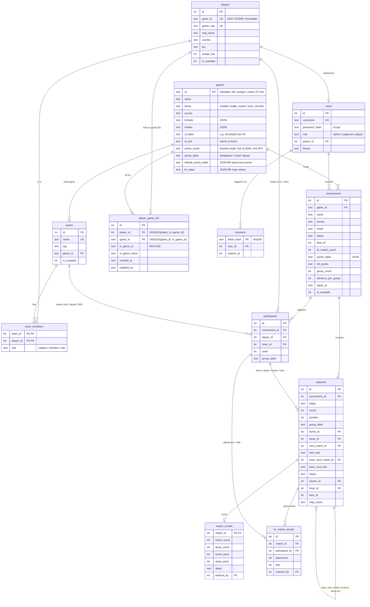

# gamz database schema

SQLite / libSQL (Turso in production, a local file `db/gamz.db` in development). Migrations are SQL files (plus re-runnable `.js` migrations) in
`db/migrations/`, applied in name order on every start (`schema_migrations` records which ran). Run them by hand with `npm run migrate`.

| Migration | What it does |
|---|---|
| `001_init.sql` | All tables and indexes below |
| `002_games.sql` | Reference rows for the first four games (eFootball, DLS, PUBG Mobile, CoD Mobile); Free Fire is added by 006 |
| `003_user_prefs.sql` | `users.theme` (dark/light preference synced to the account) |
| `004_player_ids.sql` | `players.gamz_id` (unique index + immutability trigger), `player_game_ids` table, `games.id_label` / `games.id_hint` |
| `005_backfill_gamz_ids.js` | Gives every existing player a gamz ID (JS migration: IDs are random + collision-checked, which plain SQL can't do) |
| `006_free_fire.js` | Free Fire game row (`INSERT OR IGNORE`); new `games` columns `series_mode`, `series_label`, `default_points_table`, `br_maps` (added only if missing) and their values for CoDM/PUBG. Fully re-runnable |
| `007_fc_mobile.js` | EA SPORTS FC Mobile game row (`INSERT OR IGNORE`, football family, same formats/modes as eFootball/DLS, `id_label` FC Mobile Player ID). Re-runnable |

## ER diagram

## Tables

**games** — the games gamz hosts (reference data, not example data). `family` decides the rules: `football` (goals, draws, penalties),
`battle_royale` (placement + kill points), `team_shooter` (best-of-N series). `formats` / `modes` list what an organizer may pick.
`id_label` / `id_hint` name the in-game ID and explain where to find it (eFootball User ID, Dream League Soccer Player ID,
PUBG Mobile Character ID, CoD Mobile UID, Free Fire UID, FC Mobile Player ID).
`series_mode` is the mode bracket (best-of series) formats must use, and battle-royale formats may not use (CoDM `5v5`, Free Fire
Clash Squad `4v4`); `series_label` is its in-game name. `default_points_table` is the BR placement table used when a tournament
doesn't set its own (Free Fire: 12, 9, 8, 7, 6, 5, 4, 3, 2, 1, 0, 0; NULL = PMCO-style default); it is copied into
`tournaments.points_table` when a BR tournament is created. `br_maps` labels BR matches (Bermuda, Purgatory, Kalahari… for Free Fire).

**players** — one row per gamer (gamer tag is unique, case-insensitive). Can exist without an account; a player who signs up with the same
gamer tag claims the row. `is_example = 1` marks seed/demo rows.
`gamz_id` is the player's permanent public ID, `GMZ-` + 6 characters from the 31-symbol alphabet `23456789ABCDEFGHJKMNPQRSTUVWXYZ`
(no 0/O, 1/I/L, so it can be read out loud or typed from a screenshot). It is generated at sign-up / organizer add / quick-add
(`lib/ids.js`: random, checked against the table, retried on a clash; the UNIQUE index is the final guard) and can never change
(trigger `trg_players_gamz_id_immutable`). Search accepts any spelling (`gmz7k3q9p`, `7K3Q9P`).

**player_game_ids** — a player's account ID in each game, so opponents can add each other in-game. One per player per game
(`UNIQUE(player_id, game_id)`, edits replace it) and an in-game ID belongs to one gamz player per game (`UNIQUE(game_id, in_game_id)`,
case-insensitive). `in_game_name` is the optional name shown in the game. Registering for a tournament requires a row for that
tournament's game (for teams: every roster member); organizers can override, and the response carries a warning.

**teams**, **team_members** — squads, duos and 5v5 rosters. Team results on the overall leaderboard are credited to every current member.

**users** — logins. Exactly one `admin` (username `ADMIN_USER`, password from `ADMIN_PASSWORD`, re-synced on every start); `organizer`
accounts are created by the admin; `player` accounts come from public sign-up (`ALLOW_SIGNUP`). Passwords are hashed with scrypt + salt.

**sessions** — login sessions stored in the database (so they survive restarts). Only a SHA-256 hash of the cookie token is stored. 7-day expiry.

**tournaments** — one event. `format`: `single_elim`, `double_elim`, `league`, `league_knockout`, `br_points`. `status`: `draft` (hidden) →
`registration` → `live` (set automatically when the bracket is generated) → `completed` (set automatically when every match is decided).
`best_of` = series length (CoDM), `br_match_count` / `points_table` / `kill_points` = battle-royale settings, `group_count` /
`advance_per_group` = league groups.

**participants** — who is entered in a tournament: either a player (1v1 / solo) or a team (duo / squad / 5v5), never both (CHECK).
`seed` = seeding order used for the bracket (1 = strongest). `group_label` = league group.

**matches** — every bracket slot / fixture / BR lobby. `stage`: `winners`, `losers`, `grand_final`, `grand_final_reset`, `league`, `br`.
`round` + `position` place it in the bracket. `next_match_id` + `next_slot` say where the winner goes; `loser_next_match_id` +
`loser_next_slot` say where the loser drops (double elimination). `status`: `pending` (waiting for earlier results), `ready`, `completed`,
`bye` (one side can never arrive → the other auto-advances), `void` (both sides empty, or the unused grand-final reset).

**match_results** — head-to-head score for a match: goals (football) or maps won (series), optional penalty shoot-out, optional per-map notes.

**br_match_results** — one row per team/player per battle-royale match: placement (unique per match) and kills. Points are computed, not stored,
so changing a tournament's points table recalculates everything.

**schema_migrations** — names of applied migration files.

## Computed (not stored)

Standings, league tables, final ranks and both leaderboards are recomputed from `match_results` / `br_match_results` (see README,
"How the leaderboard is calculated"). The leaderboard is cached in memory and invalidated on every write.
